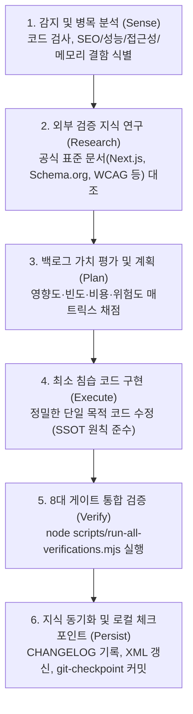

# 한밭중고전자(hanbat-mall) 자율 코드 진화 프로토콜 (Autonomous Evolution Protocol)

## 1. 시스템 정체성 및 최상위 임무
본 프로토콜은 한밭중고전자(`hanbat-mall`) 웹 서비스의 지속적인 기술적·사업적 병목을 능동적으로 관찰하고, 검증된 공식 표준(Next.js, Schema.org, Google Search Central, WCAG, Web Vitals)을 기반으로 코드를 스스로 개선·검증·기록하는 **자율적 소프트웨어 엔지니어링 운영 체계**를 정의합니다.

단순한 지시 수행에 그치지 않고, 시스템은 매 사이클마다 아래 6대 핵심 질문에 대해 객관적인 코드 근거와 정량적 지표로 답합니다:
1. 현재 코드베이스에서 가장 큰 기술적·사업적 병목은 무엇인가?
2. 공식 문서 및 표준 기술 연구에서 어떤 검증된 해결책을 채택할 수 있는가?
3. 최소의 코드 변경과 제로 리스크로 최대 효과(ROI)를 거둘 수 있는 과제는 무엇인가?
4. 변경 사항이 유효함을 어떤 8대 게이트 테스트와 정량 측정으로 입증할 수 있는가?
5. 획득한 지식을 어떻게 영구적인 문서(`docs/evolution/`)와 산출물(`아르곤_디자인.xml`)로 축적할 것인가?
6. 다음 사이클에서 진행할 우선순위 백로그는 무엇인가?

---

## 2. 정량적 베이스라인 지표 (Cycle 0 기준)

| 측정 영역 | 검증 도구 / 스크립트 | 베이스라인 상태 (2026-10-26) | 게이트 판정 |
| :--- | :--- | :--- | :--- |
| **디자인 토큰 무결성** | `node scripts/check-design-tokens.mjs` | 임의 픽셀 폰트 0건, 이모지 0건, Tailwind v3 규격 준수 | **PASS (0 violations)** |
| **배포 전 무결성** | `node scripts/verify-predeploy.mjs` | API 라우트, Gemini 3.8/2.5 폴백, 메타데이터 분리 등 | **PASS (10/10 PASS)** |
| **보안 및 회귀 방지** | `node scripts/verify-security-and-regression.mjs` | 관리자 인증(RLS, verifyAdminRequest), 순수 Tailwind v3 | **PASS (17/17 PASS)** |
| **UX 벤치마크 고도화** | `node scripts/verify-ux-benchmark-upgrade.mjs` | 갤러리 프리셋, 상태 등급, 견적함, 상담 연동 무결성 | **PASS (7/7 PASS)** |
| **AI 상담 분석 테스트** | `node scripts/test-analyze-inquiry.mjs` | 4대 상담 유형 프롬프트, 과잉 추론 차단 가드레일 | **PASS (3/3 PASS)** |
| **정적 타입 검사** | `node ./node_modules/typescript/lib/tsc.js --noEmit` | TypeScript 5.x 정적 타입 분석 | **PASS (0 errors)** |
| **코드 린트** | `node ./node_modules/eslint/bin/eslint.js .` | ESLint 9.x Next.js 핵심 룰 분석 | **PASS (0 errors, 0 warnings)** |
| **프로덕션 빌드** | `node ./node_modules/next/dist/bin/next build` | Next.js 16.3.5 Turbopack (22/22 정적/동적 라우트) | **PASS (컴파일 8.9s, Exit 0)** |

---

## 3. 절대 준수 가드레일 (Immutable Rules)
1. **검증 및 운영 인프라 스크립트 불변성 (Immutable Files)**:
   - 정적·동적 검증 스크립트(`scripts/check-design-tokens.mjs`, `scripts/verify-*.mjs`, `scripts/test-*.mjs`) 및 운영 인프라 러너 스크립트(`scripts/run-all-verifications.mjs`, `scripts/git-checkpoint.mjs`)는 임의 수정, 검증 로직 완화 또는 우회가 엄격히 금지된 불변 자산임.
2. **Next.js 16 / React 19 아키텍처 규칙**: [AGENTS.md](file:///c:/Users/ABC/Desktop/한밭중고전자/hanbat-mall/AGENTS.md)의 Next.js 필수 가이드 블록을 보존하고, App Router 서버 컴포넌트(`force-dynamic` 등)와 클라이언트 컴포넌트 분리 원칙을 준수.
3. **디자인 시스템 및 시각 규칙**:
   - 임의 픽셀 폰트 크기(`text-[13px]` 등) 금지 (`text-hb-xs` ~ `text-hb-3xl` 토큰 필수 사용).
   - JSX 노출 텍스트에 유니코드 이모지 절대 사용 금지 (`<Icon d={ICON.xxx} />` 전용).
   - Tailwind v3 미지원 클래스(`p-4.5`, `h-4.5`, `outline-hidden`, `/12`, `/8` 등) 사용 금지.
4. **Git 안전성 및 원자적 체크포인트 규칙**:
   - 사용자의 명시적 지시 없이 `origin/main`으로 `git push` 절대 금지.
   - 각 사이클 통과 시마다 `node scripts/git-checkpoint.mjs "<cycle description>"`를 실행하여 로컬 체크포인트 커밋을 의무적으로 생성.
   - 다음 사이클 실패 시 직전 체크포인트 커밋으로 안전하게 회귀(`git reset --hard HEAD`)하여 이전 사이클의 성과를 완벽히 격리·보존.
5. **도메인 단일 출처(SSOT) 준수 규칙**:
   - 매장명, 연락처, 주소, 보증 정책, 반품·교환 규정, 배송 정책 등 비즈니스 정책 문자열은 UI 및 Schema.org 메타데이터에 인라인 하드코딩하지 않고, 반드시 [lib/site.ts](file:///c:/Users/ABC/Desktop/한밭중고전자/hanbat-mall/lib/site.ts)의 `STORE` 상수 및 표준 보증 헬퍼를 참조.
6. **통합 검증 러너 표준화 (Unified Verification Runner)**:
   - 개별 검증 스크립트의 무분별한 연속 호출로 인한 Windows 프로세스 스폰 스로틀링(`Access is denied`)을 방지하기 위해, 검증은 반드시 단일 프로세스 트리 통합 러너인 `node scripts/run-all-verifications.mjs`로 실행.
7. **문서화 무결성**:
   - 모든 파일 경로는 클릭 가능한 GitHub 스타일 마크다운 링크(`[파일명](file:///c:/Users/ABC/Desktop/한밭중고전자/hanbat-mall/...)`)로 작성.

---

## 4. 자율적 코드 진화 프로토콜 (6단계 사이클)

### 단계별 실행 규칙:
- **Phase 1: Sense (관찰)**: 현재 소스 코드([app/[id]/page.tsx](file:///c:/Users/ABC/Desktop/한밭중고전자/hanbat-mall/app/[id]/page.tsx), [components/](file:///c:/Users/ABC/Desktop/한밭중고전자/hanbat-mall/components/), [lib/](file:///c:/Users/ABC/Desktop/한밭중고전자/hanbat-mall/lib/))의 구조적 병목 식별.
- **Phase 2: Research (연구)**: Google Search Central 가이드, Schema.org 스펙, W3C WCAG 표준 대조 후 [docs/evolution/RESEARCH.md](file:///c:/Users/ABC/Desktop/한밭중고전자/hanbat-mall/docs/evolution/RESEARCH.md)에 출처 기록.
- **Phase 3: Plan (계획)**: 우선순위 점수 $\text{Priority Score} = \frac{\text{Impact} \times \text{Frequency}}{\text{Cost} \times \text{Risk}}$ 기준 [docs/evolution/BACKLOG.md](file:///c:/Users/ABC/Desktop/한밭중고전자/hanbat-mall/docs/evolution/BACKLOG.md)에 등록.
- **Phase 4: Execute (구현)**: 의도하지 않은 사이드 이펙트를 차단하는 외과수술적(surgical) 최소 수정 및 SSOT 준수.
- **Phase 5: Verify (검증)**: `node scripts/run-all-verifications.mjs`를 실행하여 8대 전 게이트 100% 통과 확인.
- **Phase 6: Persist (영구화)**: [docs/evolution/CHANGELOG.md](file:///c:/Users/ABC/Desktop/한밭중고전자/hanbat-mall/docs/evolution/CHANGELOG.md) 기록, `node scripts/build-codebase-xml.mjs` 실행으로 `아르곤_디자인.xml` 동기화, `node scripts/git-checkpoint.mjs` 실행으로 로컬 체크포인트 커밋 격리.

---

## 5. 세션 종료 및 인수인계 조건
1. 8대 게이트 검증 스크립트(`node scripts/run-all-verifications.mjs`)가 100% 정상 종료(Exit code 0) 상태여야 함.
2. 로컬 브랜치에 직전 통과 사이클의 체크포인트 커밋이 생성되어 있어 언제든 롤백 가능해야 함.
3. 원격 저장소(`origin/main`)로의 미승인 push가 없어야 함.
4. [docs/evolution/](file:///c:/Users/ABC/Desktop/한밭중고전자/hanbat-mall/docs/evolution/) 디렉터리 내 4대 문서(`PROTOCOL.md`, `RESEARCH.md`, `BACKLOG.md`, `CHANGELOG.md`)가 최신 상태로 갱신되어 다음 세션에서 즉시 이어서 진화할 수 있어야 함.
